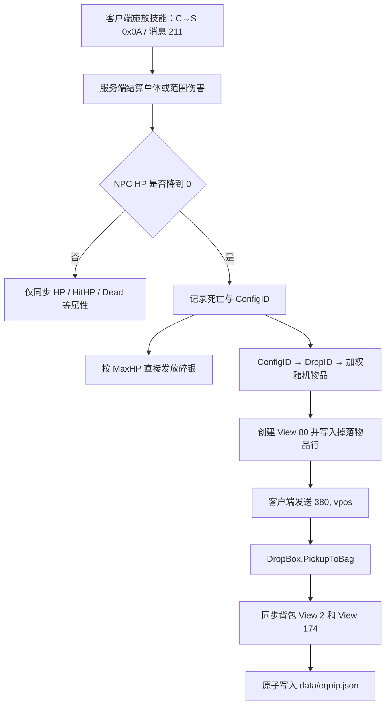

# 小怪死亡后的物品掉落实现说明

> 审计时间：2026-08-02  
> 审计对象：`E:\9yin-go-server2` 当前源码与正在运行的同目录服务端  
> 运行进程：`E:\9yin-go-server2\9yin-game-native-menu.exe`，监听 `127.0.0.1:19061/19062`

## 结论

当前“小怪死亡掉落”已经不是早期只有碎银的版本，而是两条奖励同时执行：

1. **直接增加碎银**：按死亡 NPC 的 `MaxHP / 100` 计算，最少 1、最多 99，直接写玩家 `CapitalType1`。
2. **生成物品掉落窗口**：用死亡 NPC 的 `ConfigID` 查 `DropID`，从本地掉落包随机出物品，放进客户端 `View 80`。客户端以自定义消息 `380, vpos` 逐格拾取，服务端把物品合并或放入背包，并立即持久化到 `data/equip.json`。

当前普通小怪的掉落包内容仍然是 **MVP 工程化替代数据**，不是恢复出的官方掉落包正文。NPC 到 `DropID` 的映射来自现代资源，物品 `ConfigID` 也是真实客户端物品 ID，但普通小怪包的物品、权重和数量主要由 `drops_mvp.json` 人工配置。

## 总体调用链



## 1. 哪些 NPC 被当作“小怪”

入口在 `cmd/protocol-probe/scene_lifecycle.go:166` 的 `npcCombatClassFor`。

分类规则如下：

- `ScriptClass=AttackNpc` 默认是小怪；如果 `NpcType` 属于 Boss 类型则改为 Boss。
- `ScriptClass=BossNpc`、`NewWorldBossNpc` 直接是 Boss。
- 某些副本 Creator 使用了 `CommonNpc` 模板，但只要来自 `AttackNpc.xml` / `AttackNpc_Creator.xml`，并且 `NpcType` 属于 `1、2、5、6、7、21、22、23、341、342`，仍会识别成小怪。

死亡状态在 `cmd/protocol-probe/skill_combat.go:434` 的 `settleNPCDeathLocked` 处理：

- 小怪死亡后清除仇恨；
- 不安排原地复活；
- 把实体 ID 写入 `sceneLifecycle.defeated` 墓碑集合；
- 副本中的战斗 NPC 同样保持死亡，直到副本生命周期重新建立。

这意味着当前源码把小怪当作当前场景代次中的一次性实体，即使 Creator 存在正数 `RefreshTime`，小怪也不会走普通的原地复活定时器。

## 2. 死亡判定与碎银奖励

单体技能走：

- `cmd/protocol-probe/skill_combat.go:447`：`applySelectedSkillDamageLoot`

范围技能走：

- `cmd/protocol-probe/skill_combat.go:510`：`applyShapedSkillDamage`

两条路径都会：

1. 使用服务端战斗公式计算最终伤害；
2. 调用 `actor.ApplyDamage(final)`；
3. 读取 NPC 最新状态；
4. 当 `HP <= 0` 时调用 `settleNPCDeathLocked`；
5. 下发 NPC 的 `LogicState、HPRatio、MaxHP、HP、HitHP、Dead` 属性更新；
6. 计算碎银掉落。

碎银公式是：

```text
silver = clamp(NPC.MaxHP / 100, 1, 99)
```

技能总流程在 `cmd/protocol-probe/skill_combat.go:953` 汇总所有死亡目标的碎银，调用 `player.addSilver(totalLoot)`，再通过普通玩家属性更新发送 `CapitalType1`。

因此，当前碎银不是 View 80 中的可拾取物品，而是死亡后直接入账。

## 3. 从 NPC 找到掉落物品

掉落目录在进程启动时由 `cmd/protocol-probe/drop_loot.go:297` 加载。当前目录为：

```text
E:\9yin-go-server2\resources\modern\share\drop
```

主要数据源：

| 数据 | 当前用途 | 可信边界 |
|---|---|---|
| `resources/modern/share/drop/npc_dropid.tsv` | `NPC ConfigID → DropID` | 来自现代资源整理，当前有 13,601 条映射 |
| `resources/modern/share/drop/drops_mvp.json` | `DropID → 带权物品条目` | 本地工程化 MVP；文件说明明确写着官方包正文缺失 |
| `resources/modern/ini/ui/clonescene/clone_manual.ini` | 副本 Boss 与展示掉落段关联 | 客户端副本手册/UI 数据 |
| `resources/modern/ini/ui/clonescene/clone_boss_drop.ini` | 副本 Boss 展示物品列表 | 真实物品 ID，但仍是 UI 展示表，不等同完整官方结算逻辑 |
| `resources/modern/share/clone/clonecolinfo.ini` | 副本评分档位、Boss 掉落次数 | 用于本地分档结算 |

当前加载统计：

```text
NPC→DropID 映射：13,601
MVP 掉落包：5,321
```

解析优先级在 `internal/drop/catalog.go` 中实现：

1. 如果 NPC 是副本手册 Boss，优先使用 `clone_manual.ini + clone_boss_drop.ini` 的物品列表；
2. 否则调用 `DropIDFor`（`internal/drop/catalog.go:346`）从 `npc_dropid.tsv` 找 `DropID`；
3. 再调用 `packageFor`（`internal/drop/catalog.go:367`）从 `drops_mvp.json` 找本地掉落包；
4. 查不到时回退到 `default` 药品包。

### 当前暮色之村小怪示例

映射：

```text
NpcClone003011_01..05 → NewDrop_Muse_small_monster_introduction
NpcClone003014_01..05 → NewDrop_Muse_small_monster_introduction
```

这个包目前是：

| 物品 ConfigID | 每次抽取数量 | 权重 |
|---|---:|---:|
| `yaopin_00100` | 1～2 | 60 |
| `yaopin_00300` | 1 | 30 |
| `yaopin_00500` | 1 | 10 |

所以现在暮色小怪实际上主要掉三种药品，并不是按官方 `NewDrop_Muse_small_monster_introduction` 包正文恢复出来的完整奖励。

## 4. 随机次数与分数

每个死亡 NPC 会先增加 `playerLoot.cloneScore`：

- 普通怪：`+10`
- Boss：`+120`

普通怪走 `internal/drop/score.go:208` 的 `RollForNPCWithScore`，抽取次数是：

| 当前累计分数 | 加权抽取次数 |
|---:|---:|
| `< 200` | 1 |
| `200～299` | 2 |
| `>= 300` | 3 |

同一个物品被多次抽中时会先在内存中合并数量。随机源是进程启动时间播种的 `math/rand`，因此不是可复演的确定性掉落。

副本手册 Boss 与 `clonecolinfo.ini` 的 `col_boss` 会走独立的展示列表/评分档位逻辑。

## 5. 生成 View 80 掉落窗口

技能结算在 `cmd/protocol-probe/skill_combat.go:966` 收集本次所有死亡 NPC 的 `ConfigID`，调用 `openKillDrop`（`cmd/protocol-probe/drop_loot.go:361`）。

`openKillDrop` 做以下事情：

1. 如果已有掉落窗口处于打开状态，先关闭并清空旧 `DropBox`；
2. 对每个死亡 NPC 增加分数并抽取物品；
3. 按 `ConfigID` 合并数量；
4. 最多写入 16 个不同物品栈；
5. 若掉落结果为空，强制回退为 `yaopin_00100 x1`；
6. 调用 `encodeDropOpenFrames`（`cmd/protocol-probe/drop_loot.go:225`）发包。

发包顺序：

| 顺序 | 数据 |
|---:|---|
| 1 | `0x15 SERVER_CREATE_VIEW`，创建 `View 80`，容量 16 |
| 2..N | `0x18 SERVER_VIEW_ADD`，写入每个物品槽 |
| 最后 | 当前源码发送原始 S→C `0x1E` 字符串消息 `show_hide_drop_view(1)` |

每个掉落物品至少带：

- `ConfigID`，属性索引 105；
- `Amount`，属性索引 106；
- `MaxAmount`，属性索引 110；
- 如果装备表能解析，还会附加 `ItemType、ColorLevel、Hardiness、MaxHardiness、Level`。

## 6. 客户端拾取与背包入库

现代客户端 `form_droppick.lua` 绑定 `VIEWPORT_DROP_BOX = 80`。选择物品或点击全部拾取时，会发送：

```text
C→S CustomSend(380, vpos)
```

当前服务端既能从常见的 `0x0A` activity envelope 解析 `380`，也保留顶层 `0x1E/0x27` 的兼容解析。路由位置是：

- `cmd/protocol-probe/main.go:1301`
- `cmd/protocol-probe/main.go:1460`

实际拾取由 `cmd/protocol-probe/drop_loot.go:447` 的 `handlePickupDropCustom` 完成：

1. 校验 `vpos` 在 `1..65535`；
2. 调用 `DropBox.PickupToBag`（`internal/inventory/dropbox.go:105`）；
3. 先从掉落箱拿出该物品；
4. 调用 `Bag.Add`（`internal/inventory/bag.go:82`）；
5. 背包优先合并相同 `ConfigID`，否则使用第一个空槽；
6. 背包满时返回错误，并把物品放回原掉落槽，不会吞物品；
7. 成功后向 `View 80` 发送 `0x19 SERVER_VIEW_REMOVE`；
8. 同时刷新旧背包 `View 2` 和当前新背包 `View 174`；
9. 立即调用 `persistLootGear` 持久化；
10. 最后一件拾取完后关闭并删除 `View 80`。

持久化实现在 `cmd/protocol-probe/equip_store.go:221`，目标文件是：

```text
E:\9yin-go-server2\data\equip.json
```

写入方式是“同目录临时文件 → `Sync` → `Rename` 替换”，因此背包保存是原子提交。重新登录时会恢复背包和装备快照。

掉落窗口自身不持久化；只有已经成功拾取进背包的物品会保存。

## 7. 当前运行日志的端到端证据

`E:\9yin-go-server2\logs\protocol-probe-live.log` 已记录当前实现完整跑通。例如 2026-08-02 21:43：

```text
skill defeated NPCs targets=2 silver_drop=60
opened DropBox view=80 after kills=2 slots=2 score=60
map=[NpcClone003014_02(mob)+10→NewDrop_Muse_small_monster_introduction score=50;
     NpcClone003011_02(mob)+10→NewDrop_Muse_small_monster_introduction score=60]
pickup 380 vpos=2 yaopin_00100 x2 -> bag[2]
pickup 380 vpos=1 yaopin_00300 x1 -> bag[8]; drop empty closed
```

这证明了当前运行版本中：死亡识别、碎银增加、`DropID` 映射、View 80 创建、客户端 `380` 拾取、背包合并都实际发生过。

## 8. 已发现的风险与不一致

### 8.1 普通小怪包不是官方掉落正文

`drops_mvp.json` 自身说明为：

```text
MVP engineered drop packs: DropID package bodies missing from share;
items are real shop ConfigIDs
```

因此目前只能称为“真实 NPC DropID + 真实物品 ID + 本地配置的掉落内容”，不能称为已经恢复官方物品、概率和数量。

### 8.2 当前开/关窗消息明确被现代客户端拒绝

`encodeDropOpenFrames` 和 `encodeDropCloseFrames` 仍发送原始 S→C `0x1E` 字符串 `show_hide_drop_view`。当前客户端 `bin64/trace.log` 在每次开关时都明确记录：

```text
(GameMessageHandler::OnCustom)custom msg type error [show_hide_drop_view]
```

所以这条字符串消息不是有效的现代开窗通道。当前 View 80 仍然产生了真实 `380` 拾取，说明物品视图/客户端其他行为让掉落链能够继续，但不能把 `show_hide_drop_view` 写成已验证成功的传输。项目既有证据指向数字回调 `238, open_type=1`；当前源码没有使用它，应单独修正并重新做客户端视觉验证。

### 8.3 登录默认会额外打开演示掉落

`cmd/protocol-probe/main.go:40` 把 `-demo-drop` 默认设为 `true`。第一次 `ClientReady` 后，服务端会额外生成一份药品演示掉落。这与小怪死亡掉落是两条不同入口，但会污染实际掉落测试。要做纯战斗验证，应以 `-demo-drop=false` 启动。

### 8.4 新掉落会清掉尚未拾取的旧掉落

如果 `loot.drop.Open == true`，下一批死亡会先关闭并 `Clear()` 旧掉落箱。因此连续击杀时，前一批没捡完的物品可能直接丢失。

### 8.5 副本小怪分数当前会重复累计

`openKillDrop` 已经为每只普通怪执行一次 `+10`，之后 `cloneOnKill` 在非 Boss 分支又执行一次 `+10`（`cmd/protocol-probe/clone.go:1762`）。所以副本小怪实际每只会让长期 `cloneScore` 增加 20；当前这一次掉落使用第一次加分后的分数，下一只则从重复加分后的值继续。运行日志中的 `score=10、30、50、...` 正好证明了这个现象。

Boss 分支已有“`openKillDrop` 已加分”的保护说明，但普通怪分支没有。若设计意图是一怪一次计分，这里属于确定的重复计分问题。

### 8.6 16 个槽之后的不同物品会被截断

批量/AoE 击杀先用 Go `map` 合并物品，再最多写 16 个不同栈。超过 16 个时直接停止；而 `map` 遍历顺序不稳定，因此被保留的 16 种物品也不是确定的。

### 8.7 背包堆叠没有执行 MaxAmount 上限

`Bag.Add` 只要找到相同 `ConfigID` 就直接累加数量，没有按物品 `MaxAmount` 拆栈或封顶。当前药品少量掉落不容易触发，但长期运行后可能生成超大栈。

### 8.8 只有技能击杀路径会打开普通死亡掉落

当前 `openKillDrop` 只从玩家技能 `211` 的结算尾部调用。以后如果加入环境伤害、队友伤害、宠物伤害或 GM 伤害，它们即使把 NPC HP 降为 0，也不会自动继承这套掉落，除非统一接入死亡事件。

### 8.9 当前没有队伍分配、归属、距离和超时规则

`playerLoot` 是单连接状态。谁的连接执行了击杀结算，掉落就进入谁的 View 80；没有队伍掷点、伤害归属、尸体距离检查、掉落保护时间或超时回收。

## 9. 建议的修正顺序

如果下一步准备继续完善，建议按以下顺序处理：

1. 删除/替换被客户端拒绝的 `show_hide_drop_view` 原始 `0x1E` 字符串，接入已证明的现代数字开窗回调并做视觉验证；
2. 把 `-demo-drop` 默认值改为 `false`，避免登录演示奖励污染真实战斗；
3. 消除 `openKillDrop` 与 `cloneOnKill` 的小怪重复计分；
4. 新掉落到来时合并到现有 `DropBox`，不要清空未拾取奖励；
5. 为 16 槽溢出定义确定策略，并按稳定顺序写槽；
6. 让 `Bag.Add` 遵守 `MaxAmount` 并自动拆栈；
7. 把掉落触发从技能处理器抽成统一的 `OnNPCDeath` 服务端事件；
8. 最后再恢复官方 DropID 包正文、概率、绑定规则、队伍分配和所有权规则。

## 10. 关键代码索引

| 位置 | 作用 |
|---|---|
| `cmd/protocol-probe/scene_lifecycle.go:166` | NPC 小怪/Boss 分类 |
| `cmd/protocol-probe/skill_combat.go:434` | NPC 死亡、墓碑、复活策略 |
| `cmd/protocol-probe/skill_combat.go:447` | 单体伤害、死亡和碎银计算 |
| `cmd/protocol-probe/skill_combat.go:510` | 范围伤害、批量死亡和碎银计算 |
| `cmd/protocol-probe/skill_combat.go:953` | 碎银直接入账 |
| `cmd/protocol-probe/skill_combat.go:966` | 死亡 ConfigID 进入物品掉落流程 |
| `cmd/protocol-probe/drop_loot.go:361` | 按 DropID 抽取并打开 View 80 |
| `cmd/protocol-probe/drop_loot.go:225` | View 80 开窗帧编码 |
| `cmd/protocol-probe/drop_loot.go:447` | 处理客户端 380 拾取 |
| `internal/drop/catalog.go:346` | NPC ConfigID 查 DropID |
| `internal/drop/catalog.go:391` | 加权抽取普通/手册 Boss 掉落 |
| `internal/drop/score.go:208` | 按累计分数选择抽取数量/档位 |
| `internal/inventory/dropbox.go:105` | 掉落槽事务式移入背包 |
| `internal/inventory/bag.go:82` | 背包合并/找空槽 |
| `cmd/protocol-probe/equip_store.go:221` | 背包装备持久化 |

## 11. 验证结果

本次只新增说明文档，没有修改服务端逻辑。已执行与掉落相关的聚焦测试：

```text
go test -count=1 ./internal/drop ./internal/inventory ./cmd/protocol-probe \
  -run 'Drop|Pickup|SmallMonster|CloneOnKill'
```

结果：三个包全部通过。
